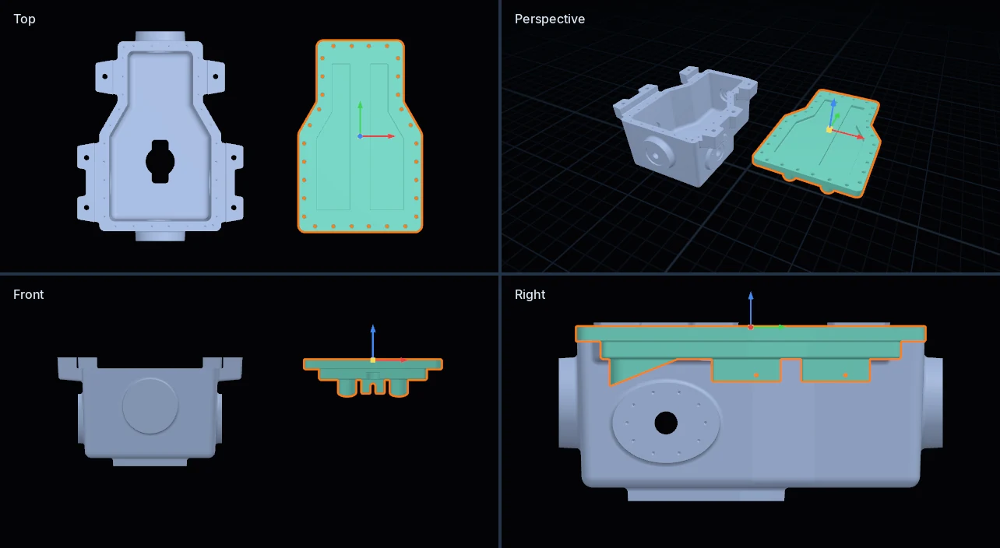

# iletki

A framework-agnostic `wgpu` viewport library for 2D and 3D CAD, GIS, and editors. Add cameras,
scene rendering, and GPU picking to a Rust application while keeping control of its window,
event loop, and GPU device.

Run the interactive desktop demo from a checkout.

```sh
cargo run --release --locked -p iletki-demo
```



## Why iletki?

- **Embed a viewport in your renderer.** Use a resolved offscreen `TextureView` or composite it
  into your own `wgpu::RenderPass`. An optional adapter supplies an `egui_wgpu` paint callback.
- **Keep local detail in large worlds.** World coordinates and cameras use `f64`. The 2D renderer
  uses split coordinates, and the 3D renderer uses camera-relative transforms and Reversed-Z.
- **Reuse work between frames.** `OnDemand` caches static geometry so a crosshair or hover
  overlay can update on its own. Choose `Continuous` for live simulation and animation.
- **Build an editor around a shared scene.** Give multiple viewports independent cameras and
  use 64-bit GPU picking, selection outlines, section planes, and transform gizmos.

## Benchmarks

Synchronized offscreen frame latency on an NVIDIA GeForce RTX 4050 Laptop GPU with Vulkan,
at 4× MSAA. Three release runs contributed samples to each workload.

| Workload | Frames | p50 | p95 |
| --- | ---: | ---: | ---: |
| Pan and zoom across 500,000 2D segments at 1024×768 | 180 | 0.31 ms | 0.47 ms |
| Update the crosshair in the same scene with zero static redraws | 90 | 0.10 ms | 0.13 ms |
| Orbit 100,000 instanced boxes (1.2 million triangles) at 800×600 | 180 | 1.47 ms | 1.67 ms |

[Benchmark commands, measurement scope, and raw CSV data](docs/benchmarks.md)

## Quick start

```rust
use iletki::{
    Camera, Mesh3D, PickId, Scene3DLayer, StandardView, Vec3,
    ViewportConfig, ViewportHost, ViewportLayer, Bounds3,
};

// 1. Create a viewport sharing your existing wgpu::Device
let mut host = ViewportHost::new(&device, ViewportConfig::default())?;

// 2. Build a 3D scene anchored at f64 world coordinates
let mut scene = Scene3DLayer::new(1);
let mut mesh = Mesh3D::at_origin(Vec3::ZERO);
mesh.push_box_with_edges(
    Vec3::splat(-1.0),
    Vec3::splat(1.0),
    [70, 185, 235, 255],
    [12, 16, 24, 110],
    PickId::new(1, 42, 0),
    true,
);
let id = scene.insert(mesh);
scene.set_selected(id, true); // Enables Jump-Flood selection outline

// 3. Frame a standard CAD isometric view
let bounds = Bounds3::from_corners(Vec3::splat(-1.0), Vec3::splat(1.0));
let (cam, _pivot) = Camera::standard_view_3d(
    StandardView::Isometric,
    bounds,
    host.logical_size(),
    1.2,
    true,
);
*host.camera_mut() = cam;

// 4. Render to a zero-copy TextureView (or use prepare_for_pass / paint_into_pass)
let mut layers: [&mut dyn ViewportLayer<()>; 1] = [&mut scene];
let frame = host.render_to_texture(&device, &queue, &mut encoder, &(), &mut layers);
```

For native asynchronous picking in an event-driven UI, submit the frame, call `begin_pick_rect`, and schedule checks with `PendingPick::try_read` until the result is ready. WebGPU drives its mapping callbacks asynchronously. See the [`ViewportHost` API](crates/iletki-wgpu/src/host.rs).

The [standalone egui example](examples/egui) shows how to render a viewport through an
`egui_wgpu` callback and pick an object. It uses registry dependencies. From a checkout, the
package verification command below runs it against locally built archives.

The [Slint desktop example](examples/slint) uses the `iletki-slint` adapter to display a shared
`wgpu 30` texture and demonstrate panning, zooming, resizing, and picking.

## Which crate should I use?

| Crate | Use it when |
| --- | --- |
| [`iletki`](crates/iletki) | You want the usual starting point. The default features include the GPU host and both scene layers. Choose `cad2d` or `cad3d` with default features disabled to use a single scene layer. |
| [`iletki-core`](crates/iletki-core) | You need `f64` math, cameras, navigation, or viewport input types without runtime dependencies. |
| [`iletki-wgpu`](crates/iletki-wgpu) | You have your own rendering layers and need a viewport host with render targets, caching, compositing, and picking. |
| [`iletki-2d`](crates/iletki-2d) | You need split-precision lines and fills, spatial culling, grids, or overlays for 2D drawings. |
| [`iletki-3d`](crates/iletki-3d) | You need 3D meshes, instancing, selection outlines, section planes, or transform gizmos. |
| [`iletki-egui`](crates/iletki-egui) | You use `egui` or `eframe` and want a paint callback and input translation for your viewport. |
| [`iletki-slint`](crates/iletki-slint) | You use Slint and want GPU texture import, image cropping, DPI handling, and picking. |

The workspace also contains the unpublished `iletki-demo` desktop app and `xtask` development tool.
See the [architecture guide](docs/architecture.md) for crate layering and renderer integration.

## Development and CI

```sh
# Headless visual showcase (writes PNGs and timing CSVs to target/showcase)
cargo run --release --locked -p iletki --example showcase

# Full quality gate (fmt, clippy, tests, docs, cargo-deny, wasm32)
rustup target add wasm32-unknown-unknown
cargo install --locked cargo-deny
cargo xtask ci
```

Run `python3 .github/scripts/package-smoke.py` with Python 3.12 or later to build the archives used
by the standalone egui example and run it from their extracted contents. The example needs a
working `wgpu` adapter. Run `cargo package --locked -p iletki-slint` to verify the Slint adapter
archive against the published iletki dependencies.

## Platform tests

The [CI workflow](.github/workflows/ci.yml) checks rendered pixels and 64-bit picking on
Linux/Vulkan (Mesa lavapipe), Windows/DX12, macOS/Metal, and Chrome/WebGPU (SwiftShader).
Each job requires its named backend. These headless tests cover offscreen rendering and picking.
The standalone egui example also checks compositing into an egui render pass.

## Support iletki

If iletki helps your project, you can support its development through [GitHub Sponsors](https://github.com/sponsors/furkankarli).

## License

Licensed under either of [Apache License, Version 2.0](LICENSE-APACHE) or
[MIT license](LICENSE-MIT) at your option.
