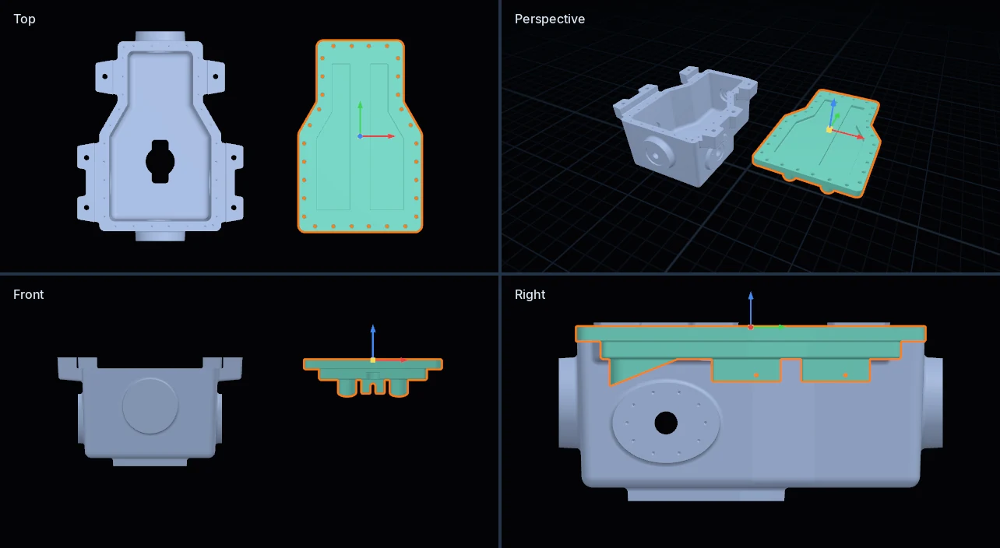
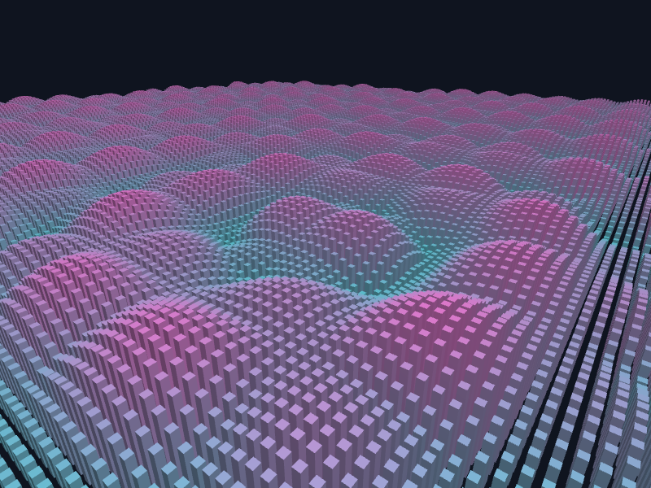

# iletki

A framework-agnostic `wgpu` viewport library for 2D and 3D CAD, GIS, and editors. Add a camera,
render layers, and GPU picking to an existing Rust application. The application owns the window,
event loop, and GPU device.

[API documentation](https://docs.rs/iletki) · [Source and demos](https://github.com/furkankarli/iletki) · [Support iletki](https://github.com/sponsors/furkankarli)



## Get started

```sh
cargo add iletki
```

The default features include the `wgpu` 30 host and the 2D and 3D scene layers. Choose `cad2d` or
`cad3d` with default features disabled to include a single scene layer. Disable all default
features to use the cameras, math, and viewport contracts on their own.

Create a host with your existing device, then render your scene layers into a resolved
`TextureView`. Use `FrameOutput::uv_max` to sample the active area of the texture. To composite
directly into your render pass, call `prepare_for_pass` and then `paint_into_pass`.

See the [renderer quick start](https://github.com/furkankarli/iletki#quick-start)
and [standalone egui example](https://github.com/furkankarli/iletki/tree/main/examples/egui).
Add [`iletki-egui`](https://crates.io/crates/iletki-egui) for the optional `egui_wgpu` callback
and input adapter.

Run the interactive desktop demo from a repository checkout.

```sh
cargo run --release --locked -p iletki-demo
```

## What you can build

- **CAD viewport.** Update a crosshair or hover overlay while reusing cached static geometry.
- **Large-world visualization.** Keep camera and world coordinates in `f64`. The 2D renderer
  uses split coordinates, and the 3D renderer uses camera-relative transforms and Reversed-Z.
- **Multi-view editor.** Give several viewports independent cameras while sharing one scene.
  Use 64-bit GPU picking, selection outlines, section planes, and transform gizmos.

The [CI workflow](https://github.com/furkankarli/iletki/actions/workflows/ci.yml) checks offscreen
rendering and picking on Linux/Vulkan, Windows/DX12, macOS/Metal, and Chrome/WebGPU.

## Benchmark

Synchronized offscreen frame latency across three release runs on an NVIDIA GeForce RTX 4050
Laptop GPU with Vulkan and 4× MSAA.

| Workload | Frames | p50 | p95 |
| --- | ---: | ---: | ---: |
| Pan and zoom across 500,000 2D segments at 1024×768 | 180 | 0.31 ms | 0.47 ms |
| Crosshair updates in that scene with zero static redraws | 90 | 0.10 ms | 0.13 ms |
| Orbit 100,000 instanced boxes at 800×600 | 180 | 1.47 ms | 1.67 ms |



[Benchmark commands, measurement scope, and raw CSVs](https://github.com/furkankarli/iletki/blob/main/docs/benchmarks.md)

## Support iletki

If iletki helps your project, you can support its development through [GitHub Sponsors](https://github.com/sponsors/furkankarli).

## License

Licensed under either [MIT](https://github.com/furkankarli/iletki/blob/main/LICENSE-MIT) or
[Apache 2.0](https://github.com/furkankarli/iletki/blob/main/LICENSE-APACHE) at your option.
